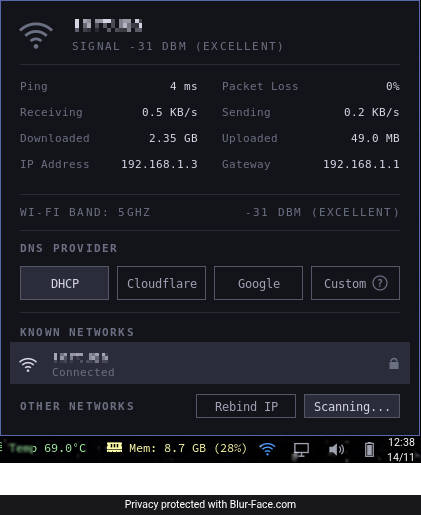
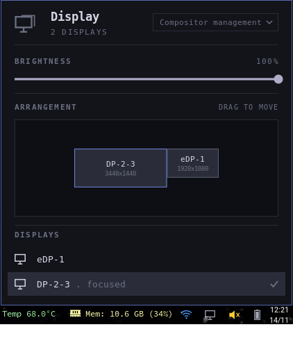
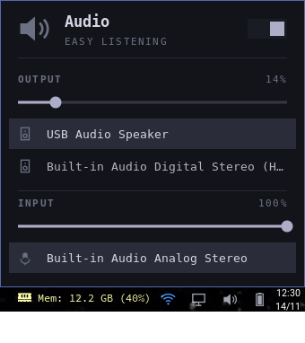
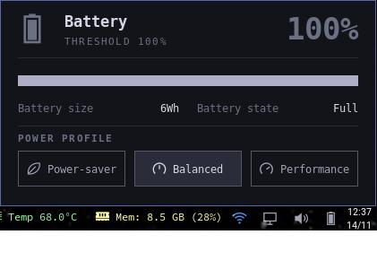

# kwort-systray

A lightweight X11 system tray application for the [Kwort Linux](https://kwort.org)
desktop. It docks four icons into the panel's system tray (tint2 on Kwort):
**network**, **display**, **audio** and **battery**. Clicking an icon opens a
popup for that area. The application is written in C using Xlib/XRandR, cairo
and pango, with no toolkit dependency.

Each icon is its own XEmbed client window docked through the freedesktop
system tray protocol (`_NET_SYSTEM_TRAY_Sn`). If the tray restarts, for example
when tint2 re-executes itself after a compositor change, the icons dock again
on their own.

While the systray is 100% compatible with Kwort, it should run with no 
modification required (or small adjustments).

## Features

### Network



- Wi-Fi network name, signal strength (dBm and quality) and band (2.4/5/6 GHz),
  read from nl80211 through libnl.
- Ping and packet loss to the default gateway, measured continuously in a
  background thread.
- Receive and send rates, total downloaded and uploaded, IP address and gateway.
- **DNS provider** selector: DHCP, Cloudflare (`1.1.1.1`, `1.0.0.1`), Google
  (`8.8.8.8`, `8.8.4.4`) or Custom (`127.0.0.1`, for a local resolver). The
  active provider is detected from `/etc/resolv.conf`.
- **Known networks** (from wpa_supplicant) and **other networks** (from a
  Wi-Fi scan), with an encryption indicator. Choosing a network that needs a
  password opens a password dialog.
- **Rebind IP**: asks dhcpcd to renew the lease.
- Tooltip: the SSID, `<iface> (wired)`, or "No network".

### Display



- **Brightness** slider for the backlight (`/sys/class/backlight`). Scrolling
  over the slider also works.
- **Arrangement**: drag and drop the monitors to arrange them. Placement snaps
  to the nearest position where monitors don't overlap.
- **Displays** list: left-click a display to make it primary. Right-click opens
  a *Disable display* menu. You can't disable the last active display, and
  disabling the primary moves the primary to the laptop panel (eDP/LVDS) or to
  another active display.
- When the primary display changes, tint2 and the systray are restarted so the
  panel moves to the new primary.
- **Compositor management** menu, for UI glitches or a misbehaving compositor:
  *Restart compositor*, *Stop compositor* and *Disable/Enable compositor*.

### Audio



- Output volume slider and output device list. Clicking a device makes it the
  default sink.
- Input volume slider and input device list (default source).
- Mute toggle in the header.
- Over the tray icon, the **scroll wheel** changes the volume and a
  **middle-click** toggles mute. The icon turns yellow while muted.
- Updates live through PulseAudio subscriptions, and also works with
  PipeWire's pulse server. It reconnects if the server restarts.

### Battery



- Charge percentage, charge bar, battery size (Wh) and state, from
  `/sys/class/power_supply`.
- The charge threshold (`charge_control_end_threshold`) when the firmware
  provides one.
- **Power profile**: Power-saver, Balanced or Performance. A profile sets the
  cpufreq governor and the energy/performance preference on every CPU, plus the
  ACPI platform profile when available.

## Building and installing

```sh
make
make install                       # installs into / using sudo
make install DESTDIR="$PWD/pkg"    # staged install for packaging (no sudo)
```

Install paths can be overridden: `PREFIX` (default `/usr`), `SCRIPTDIR`
(`/usr/lib/kwort`), `UDEVDIR` (`/etc/udev/rules.d`), `XINITRCDIR`
(`/etc/X11/xinit/xinitrc.d`) and `SUDOERSDIR` (`/etc/sudoers.d`).

Start it with your session, after the panel, e.g. from `~/.xinitrc` or your
autostart:

```sh
kwort-systray &
```

### What `make install` sets up

| Installed file | Mode | Purpose |
|---|---|---|
| `$(PREFIX)/bin/kwort-systray` | 0755 + `cap_net_admin+ep` | The application |
| `$(SCRIPTDIR)/network-setup.sh` | 0755 | Wi-Fi, DNS and DHCP helper |
| `$(SCRIPTDIR)/power-profile.sh` | 0755 | Power profile helper |
| `$(SCRIPTDIR)/compositor.sh` | 0755 | Compositor control |
| `$(SCRIPTDIR)/display-change.sh` | 0755 | Display hotplug and panel restart |
| `$(UDEVDIR)/89-kwort-video.rules` | 0644 | Backlight permissions and display hotplug |
| `$(XINITRCDIR)/0-compositor.sh` | symlink | Starts the compositor with X (created on first install only) |
| `$(SUDOERSDIR)/kwort-systray` | 0440 | Passwordless sudo for the helper scripts |

When installing directly into the system (no `DESTDIR`), it also reloads the
udev rules and re-triggers the backlight devices so the new permissions apply
right away.

## Internal setup

### Binary capabilities

The binary needs the **`CAP_NET_ADMIN`** file capability. Starting an nl80211
Wi-Fi scan (`NL80211_CMD_TRIGGER_SCAN`) is a privileged netlink operation.
Without the capability the network popup still works, but it only shows
networks from scans other programs have triggered.

`make install` covers this. It runs:

```sh
setcap cap_net_admin+ep /usr/bin/kwort-systray
```

For a staged install (`DESTDIR`), setcap is attempted but allowed to fail
because it often needs root or a filesystem that keeps extended attributes. A
package must then apply the capability itself in its post-install step.
Rebuilding or copying the binary drops the capability, so run `make install`
again afterwards.

Ping uses an unprivileged ICMP datagram socket. If the
`net.ipv4.ping_group_range` sysctl doesn't include the user's group, it falls
back to `ping(8)`.

### Helper scripts

The binary never runs privileged commands itself. Every change to the system
goes through a helper script in `$(SCRIPTDIR)` (`/usr/lib/kwort`). When a
script is not running as root, it re-runs only the privileged step through
`sudo -n`, which the installed sudoers file allows without a password.

#### `network-setup.sh`

```
network-setup.sh WIFI   <iface> <essid> <address> <open|wep|wpa|wpa2|wpa3>
network-setup.sh DNS    <dhcp|cloudflare|google|custom> [iface]
network-setup.sh REBIND <iface>
```

- **WIFI** adds the network to wpa_supplicant through `wpa_cli`, or updates
  its password if it already exists, then selects it and saves the
  configuration. The password comes from the `WIFI_PASSWORD` environment
  variable and is never logged. This needs `update_config=1` in
  `wpa_supplicant.conf`.
- **DNS** rewrites `/etc/resolv.conf` and keeps its `search`, `domain` and
  `options` lines. It uses `sudo -n tee /etc/resolv.conf` when not root.
  `dhcp` renews the DHCP lease instead, so dhcpcd rewrites the file.
- **REBIND** runs `dhcpcd -n -- <iface>` as root. The interface name is
  checked first, and names starting with `-` are rejected so they can't be
  passed to dhcpcd as options.
- Messages go to syslog with the tag `network-setup`.

#### `power-profile.sh`

```
power-profile.sh <power-saver|balanced|performance>
power-profile.sh get
```

Writes `scaling_governor` and `energy_performance_preference` for every CPU
and `/sys/firmware/acpi/platform_profile` when present. It re-runs itself
through `sudo -n` to write to sysfs.

#### `compositor.sh`

```
compositor.sh [start] | stop | restart | enable | disable | status
```

- The compositor command is set at the top of the script
  (`KWORT_COMPOSITOR="xcompmgr -c -f -C -r 5 -o .6 -D 5"`). Edit it to use
  another compositor.
- `/etc/X11/xinit/xinitrc.d/0-compositor.sh` is a **symlink to this script**.
  xinitrc *sources* the files in that directory. When sourced, the script only
  starts the compositor in the background.
- **`disable` stops the compositor and removes that Xorg symlink**, so the
  compositor no longer starts with X. **`enable` creates the symlink again**
  and starts the compositor. Changing `/etc` needs root, so these two run
  `sudo -n compositor.sh --link on|off`.
- `start`, `stop` and `restart` run as the user and don't need sudo.
- `make install` creates the symlink only on the first install, so a later
  `make install` doesn't undo a *disable*.

#### `display-change.sh`

```
display-change.sh                  # run by udev
display-change.sh --restart-panel  # run by kwort-systray or by itself
```

- **udev calls this script whenever a display is plugged in or unplugged**
  (a DRM `change` uevent on `card0`, see `89-kwort-video.rules`). It detaches
  from udev, waits for the change to settle and gets the X session's
  environment from the running tint2 or kwort-systray process.
  - If a display was unplugged but is still active, it's turned off with
    `xrandr --off`. If it was the primary, the primary moves to the laptop
    panel or to another active display.
  - A newly plugged display gets a "jumpstart": it's turned off, then turned
    on again with `--auto --right-of <primary>`. Some monitors otherwise show
    "no signal" even though X considers them active.
  - Afterwards it restarts the panel as the desktop user.
- `--restart-panel` stops every tint2 and kwort-systray process of the user,
  which also cleans up duplicates, and starts one of each again with its
  original command line and environment. A per-user lock
  (`/run/user/<uid>/kwort-panel.lock`) stops two restarts from overlapping.
  kwort-systray also uses this after changing or disabling the primary
  display.
- State and lock files: `/run/kwort-display.state` and
  `/run/kwort-display.lock`. Messages go to syslog with the tag
  `display-change`.

#### Overriding script paths

Useful for development. kwort-systray reads these environment variables:

| Variable | Default |
|---|---|
| `SYSTRAY_NET_SCRIPT` | `/usr/lib/kwort/network-setup.sh` |
| `SYSTRAY_POWER_SCRIPT` | `/usr/lib/kwort/power-profile.sh` |
| `SYSTRAY_DISPLAY_SCRIPT` | `/usr/lib/kwort/display-change.sh` |
| `SYSTRAY_COMPOSITOR_SCRIPT` | `/usr/lib/kwort/compositor.sh` |
| `SYSTRAY_WPA_DIR` | `/var/run/wpa_supplicant` (control socket directory) |

### udev rules (`89-kwort-video.rules`)

- **Backlight:** when a backlight device appears, its `brightness` file is
  given to the **`video`** group and made group-writable, so members can
  change brightness without root.
- **Display hotplug:** a DRM `change` event on `card0` runs
  `/usr/lib/kwort/display-change.sh`.

### sudoers (`kwort-systray.sudoers`)

Installed as `/etc/sudoers.d/kwort-systray`, mode 0440. Members of the
**`users`** group may run the following as root without a password:

| Script | Allowed command |
|---|---|
| `power-profile.sh` | `power-profile.sh power-saver`, `balanced`, `performance` |
| `compositor.sh` | `compositor.sh --link on`, `--link off` |
| `network-setup.sh` | `tee /etc/resolv.conf` |
| `network-setup.sh` | `network-setup.sh REBIND <iface>` |

- Each rule allows one exact command line. The only exception is REBIND, where
  the script checks the interface name itself. dhcpcd is deliberately not
  allowed directly, because its options (such as `-c <script>`) could run
  arbitrary code as root.
- `requiretty` is turned off for these commands, because the systray has no
  terminal.
- `make install` rewrites the paths to match `SCRIPTDIR` and checks the file
  with `visudo -cf` when available. A file that fails the check isn't
  installed.
- The file must be **owned by root**, or sudo ignores it. Make sure your
  package sets root ownership.
- To allow a different group, edit `User_Alias KWORT_USERS = %users`, e.g.
  `%wheel`.

### Groups

| Group | Needed for |
|---|---|
| `users` | Passwordless sudo for the helper scripts: power profiles, DNS, DHCP rebind, compositor enable/disable |
| `video` | Writing the backlight `brightness` file (brightness slider) |
| wpa_supplicant's `ctrl_interface_group` (e.g. `netdev` or `wheel`) | Talking to wpa_supplicant: known networks, connecting to Wi-Fi |

For wpa_supplicant, use for example
`ctrl_interface=DIR=/var/run/wpa_supplicant GROUP=wheel` and
`update_config=1` in `/etc/wpa_supplicant.conf`, then add the user to that
group.

## Dependencies

### Build time

- A C compiler (gcc by default), `make` and `pkg-config`
- Development files for: `x11`, `xrandr`, `cairo`, `cairo-xlib`, `pango`,
  `pangocairo`, `glib-2.0`, `libpulse`, `libnl-3.0` and `libnl-genl-3.0`
- Linux kernel headers (`linux/nl80211.h`)

### Run time

| Dependency | Used for |
|---|---|
| Xorg with RandR, libX11, libXrandr | Tray icons, popups, monitor layout |
| cairo, pango, glib | Drawing and text |
| libpulse (PulseAudio, or PipeWire with pipewire-pulse) | Audio |
| libnl-3 / libnl-genl-3 | Wi-Fi information and scans (nl80211) |
| `xrandr` | Changing the display layout, primary display, enabling and disabling displays |
| tint2 (or another freedesktop system tray) | Hosting the icons. Panel restarts expect tint2 |
| `wpa_supplicant` and `wpa_cli` | Wi-Fi networks and connecting |
| `dhcpcd` | DHCP rebind and DNS from DHCP |
| `sudo` | Privileged steps of the helper scripts |
| eudev or systemd-udev | Display hotplug and backlight permissions |
| `setcap` (libcap) | Setting `cap_net_admin` at install time |
| `bash`, `util-linux` (`flock`, `setsid`, `logger`), `procps` (`pgrep`, `pkill`) | Helper scripts |
| `xcompmgr` (or the compositor configured in `compositor.sh`) | Compositor management |
| `ping` (iputils), optional | Ping fallback when unprivileged ICMP sockets aren't allowed |
| cpufreq / ACPI `platform_profile` support in the kernel | Power profiles |
